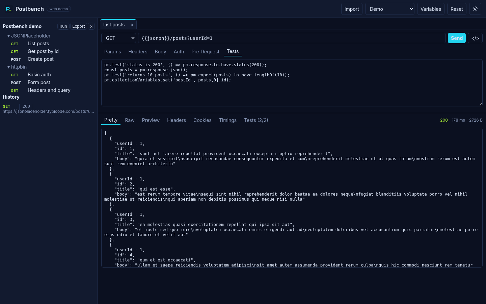
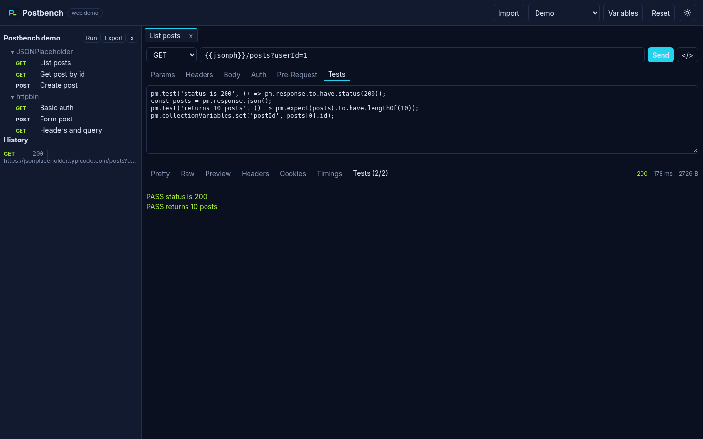
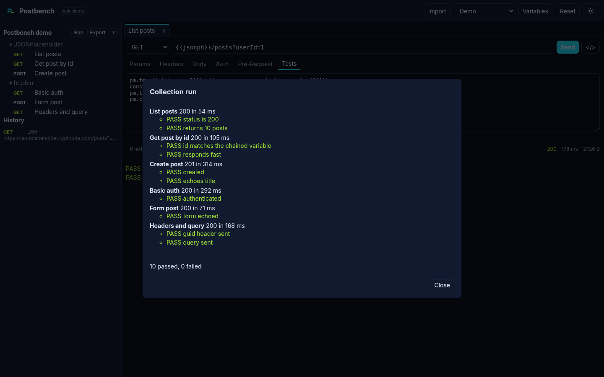
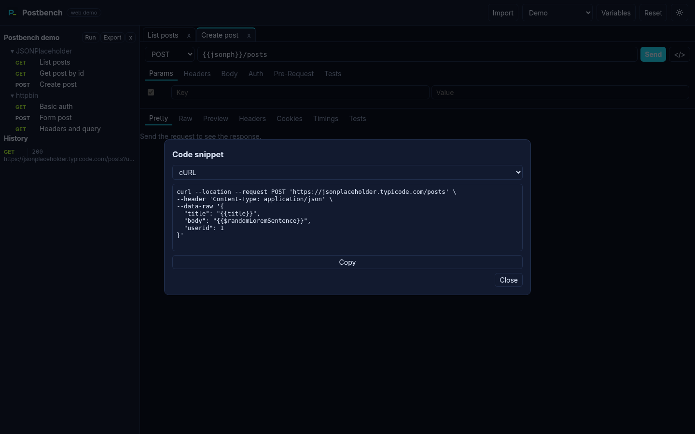
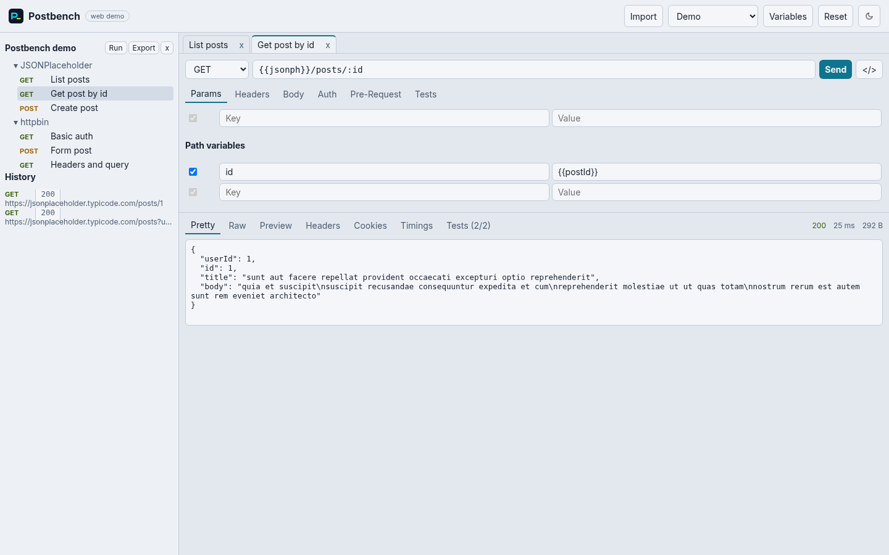

# Postbench

Open-source, local-first API client and collection runner that reads, runs and writes Postman Collection v2.1 files, with results checked against newman.

[](https://postbench.vercel.app)
[](https://github.com/devtechedge/postbench/actions/workflows/ci.yml)
[](https://www.typescriptlang.org/)
[](https://react.dev/)
[](https://www.electronjs.org/)
[](packages/conformance/results/REPORT.md)
[](LICENSE)

---

## Live Demo

**https://postbench.vercel.app**

> **Status:** the web demo runs fully in your browser. Requests go out with `fetch`, so targets must allow CORS, and AWS SigV4, OAuth 1 and Digest signing need the desktop app or the CLI. Your workspace is kept in `localStorage`. The demo collection calls JSONPlaceholder and httpbin.

---

## Screenshots

| Request and response | Test results |
|---|---|
|  |  |

| Collection runner | Code snippets |
|---|---|
|  |  |

| Light mode |
|---|
|  |

---

## Features

- **Lossless Collection v2.1**: import and export with byte stable round trips on real exports, plus environments, globals and CSV or JSON data files.
- **Postman variable semantics**: local, data, environment, collection and globals precedence, nested resolution and `$guid`, `$timestamp`, `$random*` dynamic variables.
- **Request engine**: every body mode including GraphQL, Basic, Bearer, API key, OAuth 1, OAuth 2 token, Digest and AWS SigV4 auth, cookie jar, redirects, proxies, client certificates and timing phases.
- **Script sandbox**: `pm.*` API with chai `pm.expect`, `pm.sendRequest`, `setNextRequest`, legacy `tests[]` and `postman.*`, lodash and crypto-js, isolated per script.
- **newman style CLI**: `postbench run` with the familiar flags and cli, json and junit reporters.
- **Mock server** from saved examples with name, code, delay and GraphQL operation matching.
- **Importers and codegen**: curl, HAR and OpenAPI 3 in; curl, fetch, Python requests and HTTPie out.
- **Desktop app**: Electron shell with a Node request bridge (no CORS), built as a Linux AppImage and zip in CI.

---

## Conformance with newman

The same 45 collections from the newman integration suite run through newman 6.2.3 and Postbench against a local echo server, and every request, status code and assertion is compared.

| Metric | Result |
| --- | --- |
| Collections with identical results | **30 of 42** runnable (3 v1 or non-collection files skipped) |
| Assertions matching newman | **220 of 287** (76.7%) |
| Errors | 0 |

Most remaining differences come from sandbox libraries not bundled yet (ajv, tv4, cheerio). Full table: [conformance report](packages/conformance/results/REPORT.md). Reproduce with `pnpm conformance`.

---

## Tech Stack

| Layer | Technology |
|-------|------------|
| Language | TypeScript 5, ES modules, pnpm workspaces and Turborepo |
| Core and engine | Node `http`/`https`, `node:vm`, tough-cookie, aws4, chai, lodash, crypto-js |
| Web UI | React 18 and Vite |
| Desktop | Electron 33 and electron-builder (AppImage, zip) |
| Tests | Vitest (139 tests), Playwright e2e, Electron smoke test, newman differential suite |
| Hosting and CI | Vercel (auto deploy from `main`), GitHub Actions |

---

## Quick Start

```bash
pnpm install
pnpm build
pnpm test

# Run a collection like newman
node packages/cli/dist/cli.js run my.postman_collection.json -e dev.postman_environment.json -r cli,junit

# Serve saved examples as a mock API
node packages/cli/dist/cli.js mock my.postman_collection.json -p 4010

# Web UI on http://localhost:5173
pnpm --filter @postbench/web dev

# Desktop app (Electron) and Linux packages
pnpm --filter @postbench/desktop start
pnpm --filter @postbench/desktop dist
```

Prebuilt AppImage and zip files are attached to each [release](https://github.com/devtechedge/postbench/releases) and to every CI run as the `postbench-linux` artifact.

---

## Documentation

- [Architecture](docs/architecture.md)
- [Compatibility matrix](docs/compatibility.md)
- [Evidence format](docs/evidence-format.md) and per feature specs in [`specs/`](specs)
- [Limitations](docs/limitations.md)

Behaviour is derived from the public Collection v2.1 schema, the Apache-2.0 postman-collection, postman-runtime, postman-sandbox and newman sources, and hashed evidence from analysing the Linux desktop app with [REA](https://github.com/morluto/rea). No Postman code or assets are included. Postbench is not affiliated with Postman, Inc.; "Postman" is used only to describe file format compatibility. See [third party notices](THIRD_PARTY_NOTICES.md).

---

## License

MIT. See [LICENSE](LICENSE).
